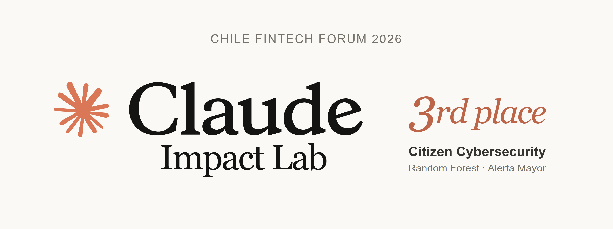

  

## Jonathan Siesquen Zuloaga

Full-stack developer focused on React, TypeScript and Node.js. I build web applications with real-time data, interactive maps and 3D visualization, from interface to backend and deployment.

Currently learning software architecture, infrastructure and DevOps through hands-on projects.

Open to Full-stack and React/Node.js roles in Peru, Chile, and remote opportunities with international teams.

[LinkedIn](https://www.linkedin.com/in/jpsiesquen/) · [Explore my projects](#selected-work)

<table>
  <tr>
    <td align="center" width="33%">
      
       
      <a href="https://iss-tracker-siesquen.vercel.app">ISS Tracker</a>
    </td>
    <td align="center" width="33%">
      
       
      <a href="https://earthquake-tracker-siesquen.vercel.app">Earthquake Tracker</a>
    </td>
    <td align="center" width="33%">
      
       
      <a href="https://aptia.cl">Aptia / Don Tata</a>
    </td>
  </tr>
</table>

---

### Selected work

**ISS Tracker**: Real-time tracking of the International Space Station on a 3D globe. Orbital propagation with SGP4 keeps the station, Earth rotation and solar lighting synchronized. A serverless BFF validates and caches orbital data, with fallback during upstream outages. Mobile optimizations reduced texture transfer by 86% in documented local measurements.
*TypeScript, React, Three.js, WebGL.*
[Live demo](https://iss-tracker-siesquen.vercel.app) · [Code](https://github.com/JpSiesquen/iss-tracker-siesquen) · [Performance notes](https://github.com/JpSiesquen/iss-tracker-siesquen/blob/main/docs/rendimiento-movil.md)

**Don Tata**: AI-assisted WhatsApp service helping older adults recognize potential scams. As co-founder of Aptia, I develop and maintain the bot and product website, including testing and reliability improvements.
*JavaScript, Node.js, Firebase.*
[Product site](https://aptia.cl) · Private codebase

**Earthquake Tracker**: Interactive earthquake visualization combining a global map with local 3D views of seismic depth. A serverless BFF validates and caches USGS data, while the interface provides filters and handles missing data and service errors.
*TypeScript, React, MapLibre, Three.js.*
[Live demo](https://earthquake-tracker-siesquen.vercel.app) · [Code](https://github.com/JpSiesquen/earthquake-tracker-siesquen)

**Site Health Monitor**: Automated website monitoring in Python that detects failures an HTTP 200 alone can miss. Validates availability, redirect destinations and expected content, producing timestamped CSV and HTML reports with failure diagnostics. Built with the standard library, exit codes for pipeline integration, and integration tests running in GitHub Actions.
*Python, HTTP, unittest, GitHub Actions.*
[Code](https://github.com/JpSiesquen/site-health-monitor-python) · [Sample report](https://github.com/JpSiesquen/site-health-monitor-python/blob/main/docs/examples/report.html)

**Mining Operations Console**: React and TypeScript demo for reviewing haul-truck loading events, with prioritized alerts, visual evidence, operator workflows and PDF reports. A companion Node.js backend separates API Core and BFF services, with validated event contracts and HTTP integration tests. The console currently runs on simulated data.
*React, TypeScript, Node.js, Express.*
[Backend code](https://github.com/JpSiesquen/distributed-mining-monitoring-demo) · Private frontend · Demo on request

**Client web work**: Landing pages and business sites delivered for
restaurants, retail, health and professional services. *HTML, CSS,
JavaScript, Astro.*
[Gym](https://landing-gimnasio-kir.vercel.app) · [Pizzeria](https://landing-pizzas-artesanales.vercel.app) · [Food truck](https://landing-food-truck.vercel.app) · [Restaurant](https://morenaza-la-unica.vercel.app)

---

## Claude Impact Lab Chile 2026

<table width="100%">
  <tr>
    <td align="center">
      
    </td>
  </tr>
  <tr>
    <td>
      
      
<strong>3rd place — Citizen Cybersecurity.</strong>

      
As part of team Random Forest, I helped build Alerta Mayor, a conversational AI agent designed to help older adults and vulnerable people recognize financial scams and find safe support channels.

      
We competed at Claude Impact Lab Chile in Santiago on May 6–7, 2026, during Chile Fintech Forum — the first Claude Impact Lab focused on financial inclusion.

      <a href="https://fintech.benditaia.cl/es">Event</a>
    </td>
  </tr>
</table>

---

## Santander X Chile Award 2026

<table width="100%">
  <tr>
    <td align="center">
      
    </td>
  </tr>
  <tr>
    <td>
      
      
<strong>Don Tata — selected among Chile’s top five projects in the University category.</strong>

      
As co-founder of Aptia, I develop and maintain the AI-powered WhatsApp assistant, including its Claude API integration, tests and reliability improvements.

      
<em>Final ranking to be announced on November 10, 2026.</em>

      <a href="https://www.santanderx.com/es/sites/chile-award-2026.html">Competition</a> · <a href="https://aptia.cl/">Don Tata / Aptia</a>
    </td>
  </tr>
</table>

---

### Tools I work with

---

### Languages

Spanish (native) · English (intermediate)

---

### Contact

